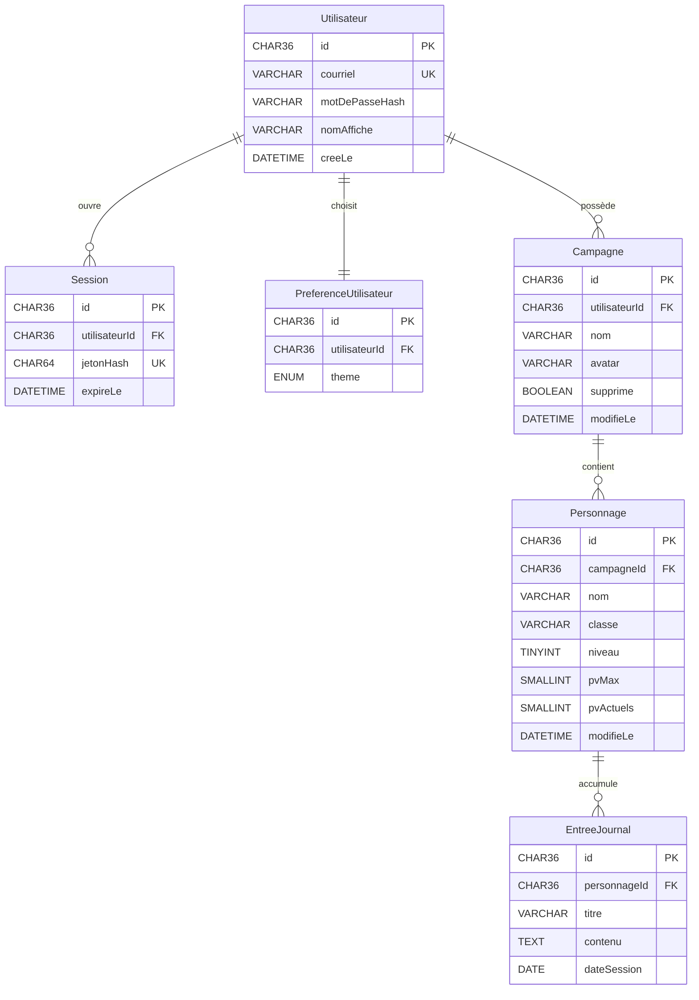

# Modèle de données — serveur MySQL

Responsable : Jayden. Source de vérité : [`serveur/bd/schema.sql`](../serveur/bd/schema.sql).
Ce document résume le schéma ; en cas de différence, c'est `schema.sql` qui fait foi.

## Diagramme



GitHub affiche ce diagramme directement. Dans VS Code : extension « Markdown Preview Mermaid Support ».

## Règles imposées par la base

MySQL 8 refuse lui-même une donnée invalide (contraintes `CHECK`), même si un validateur l'a laissée passer.

| Table | Règle | Contrainte |
| --- | --- | --- |
| Utilisateur | Courriel unique | `UNIQUE (courriel)` |
| Campagne | Nom de 2 à 60 caractères | `chkCampagneNom` |
| Personnage | Nom de 2 à 40 caractères | `chkPersonnageNom` |
| Personnage | Niveau de 1 à 20 | `chkPersonnageNiveau` |
| Personnage | `pvMax ≥ 1` et `0 ≤ pvActuels ≤ pvMax` | `chkPersonnagePv` |
| Personnage | Six caractéristiques de 1 à 20 | `chkPersonnageCaracteristiques` |
| EntreeJournal | Titre et contenu non vides | `chkJournalTitre`, `chkJournalContenu` |
| PreferenceUtilisateur | Un seul réglage par compte | `UNIQUE (utilisateurId)` |
| PreferenceUtilisateur | Thème permis | `ENUM ('PARCHEMIN', 'DONJON', 'ARCANE')` |

## Choix importants

- **Identifiants UUID générés sur le téléphone.** Une entité a le même `id` sur le mobile et sur le serveur. Un `POST` rejoué après une coupure réseau trouve l'id existant : le serveur renvoie l'enregistrement déjà reçu (200) au lieu d'en créer un deuxième.
- **Suppression logique des campagnes** (`supprime = TRUE`). Les requêtes de lecture filtrent `supprime = FALSE`.
- **Suppression d'un compte = suppression de tout son contenu** (`ON DELETE CASCADE` sur toute la chaîne). Le script de démonstration s'en sert pour se remettre à zéro.
- **Dates en UTC, avec millisecondes** (`DATETIME(3)`). `database.js` force le fuseau `+00:00` et renvoie les dates en texte (`dateStrings`), pour que `GET /sync?depuis=` compare exactement les valeurs stockées.
- **Index** sur `(utilisateurId, modifieLe)` et `(campagneId, modifieLe)` : ils servent à la fois aux listes et à la synchronisation (« ce qui a changé depuis… »).
- **`force` est un mot réservé de MySQL** : toujours l'écrire `` `force` `` dans les requêtes.

## Résumé de campagne

Calculé côté serveur par `serveur/services/resumeService.js` (en SQL : `COUNT`, `AVG`, `GROUP BY`) et côté mobile, hors ligne, par `mobile/utils/resume.js`. Les deux renvoient le même format :

```json
{
  "nombrePersonnages": 3,
  "niveauMoyen": 2.7,
  "personnagesKo": 1,
  "repartitionClasses": [{ "classe": "Clerc", "nombre": 1 }],
  "derniereEntreeJournal": { "id": "…", "titre": "…", "dateSession": "2026-11-15", "personnageNom": "Borin" }
}
```

## API du journal

| Méthode et route | Réponses |
| --- | --- |
| `GET /personnages/:id/journal` | 200 + tableau (session la plus récente d'abord) ; 404 |
| `POST /personnages/:id/journal` | 201 + entrée ; 200 si déjà reçue ; 400 + `details` par champ ; 404 ; 409 si l'id appartient à une autre entrée |

Corps attendu par le `POST` : `{ "id": "<uuid>", "titre": "…", "contenu": "…", "dateSession": "AAAA-MM-JJ" }`.
